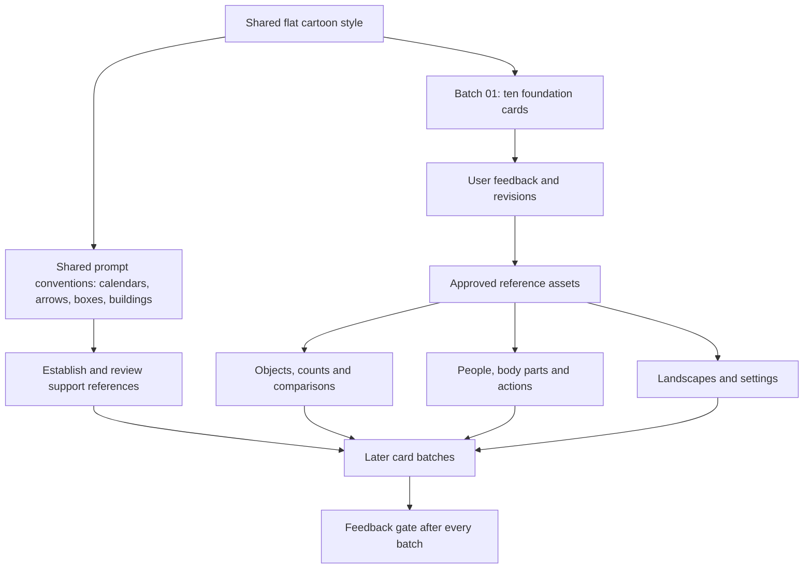

# Card generation dependency graph

Tracked in [issue #72](https://github.com/ajhconway/kikimashta/issues/72). Arrows mean “establish before using as a reference.” Visual dependencies and semantic answer exclusions are separate.

## Scoped style trials

| Profile | Reference | Status | Cards |
| --- | --- | --- | ---: |
| style:cat-png | [cat-style-reference.png](../../artifacts/card-regeneration/references/cat-style-reference.png) | approved-direction | 37 |

A style trial is an independent root in the generation graph. It replaces the previous style only for its assigned cards until user review.

## Reusable components

| Component | Seed card | Reference status | Dependent cards |
| --- | --- | --- | ---: |
| apple | リンゴ / Apple (`ja-apple`) | approved | 2 |
| ball | 玉 / Ball (`ja-v-66ccf8dd3399`) | approved | 23 |
| person | 人 / Person (`ja-v-ad7167347a2a`) | approved | 112 |
| hand | 手 / Hand (`ja-v-b1ff052549ed`) | approved | 21 |
| plate | 皿 / Plate (`ja-v-baa4dd2c5986`) | approved | 2 |
| glass | コップ / Cup (`ja-cup`) | approved | 4 |
| cow | 牛 / Cow (`ja-v-a47e21265374`) | approved | 2 |
| mountain | 山 / Mountain (`ja-v-ddd9dca106e2`) | approved | 4 |
| rice | 米 / Rice (`ja-v-0958f7553d9f`) | approved | 2 |
| stone | 石 / Stone (`ja-v-2f734ba866d9`) | approved | 1 |
| calendar | Prompt convention; support reference still to be established | prompt-convention | 44 |
| arrow | Prompt convention; support reference still to be established | prompt-convention | 29 |
| open-box | Prompt convention; support reference still to be established | prompt-convention | 2 |
| doorway | Prompt convention; support reference still to be established | prompt-convention | 12 |
| house | Prompt convention; support reference still to be established | prompt-convention | 12 |
| shop | Prompt convention; support reference still to be established | prompt-convention | 4 |
| office-school | Prompt convention; support reference still to be established | prompt-convention | 9 |
| sun-moon-horizon | Prompt convention; support reference still to be established | prompt-convention | 19 |
| tree-plant | Prompt convention; support reference still to be established | prompt-convention | 23 |
| paper-book-pencil | Prompt convention; support reference still to be established | prompt-convention | 23 |
| bowl | Prompt convention; support reference still to be established | prompt-convention | 2 |
| car-taxi | Prompt convention; support reference still to be established | prompt-convention | 4 |
| washer | Prompt convention; support reference still to be established | prompt-convention | 4 |
| numeral | Prompt convention; support reference still to be established | prompt-convention | 29 |
| flag | Prompt convention; support reference still to be established | prompt-convention | 6 |
| cat | Prompt convention; support reference still to be established | prompt-convention | 2 |
| yarn-thread-rope | Prompt convention; support reference still to be established | prompt-convention | 4 |
| gem | Prompt convention; support reference still to be established | prompt-convention | 2 |
| fabric | Prompt convention; support reference still to be established | prompt-convention | 3 |
| character-relationship | Prompt convention; support reference still to be established | prompt-convention | 15 |
| diagram-convention | Prompt convention; support reference still to be established | prompt-convention | 11 |

## Generation and feedback rules

1. Generate batch 01 from scratch. The apple is a provisional style-only reference within this first batch.
2. Review all ten cards together, including their appearance at 145px. Wait for user feedback.
3. Record feedback; revise the shared style, affected prompts and artwork before continuing. Invalidate references affected by those revisions.
4. Only approved seed artwork becomes a downstream object/character reference. Match geometry, colors and proportions; never add the reference object to an unrelated scene.
5. Unseeded components are shared prompt conventions, with no visual reference claimed. Establish and review a support reference before depending on a precise recurring design.
6. Pick up to ten cards whose reference dependencies are ready. The later order in batches.json is provisional; regroup after feedback if necessary.
7. Record exact generation prompts and reference paths in each batch manifest. Repeat the feedback gate after each batch.
8. Semantic exclusions and previous review restrictions remain. App integration and real-device checks are separate work before activation.

## Per-card dependencies

Complete machine-readable nodes and directed edges: `graph.json`. Each card inherits its assigned style profile. Foundation seeds establish their own components directly from style.

| Card ID | Japanese | Meaning | Shared components |
| --- | --- | --- | --- |
| ja-v-c0f58bfab324 | 上 | Above | ball |
| ja-v-2cc50c2d66a6 | 大人 | Adult | person |
| ja-v-7de8b40e4f57 | 一人 | Alone | person |
| ja-v-3fef4445ce13 | 人工 | Artificial | tree-plant |
| ja-v-520308b3c3b4 | 下 | Below | ball |
| ja-v-f6377dcbb564 | 大きい | Big | ball |
| ja-v-f6ed7c17c0d5 | 八 | Eight | numeral |
| ja-v-6c9351ae67e6 | 八つ | Eight Things | style only; style:cat-png |
| ja-v-20cbd1c15a35 | 入り口 | Entrance | arrow, doorway |
| ja-v-1d446778d33c | 大した | Great | style only |
| ja-v-ddd9dca106e2 | 山 | Mountain | mountain |
| ja-v-9e64feeea5ea | 口 | Mouth | style only |
| ja-v-0181fab128a1 | ふじ山 | Mt Fuji | mountain |
| ja-v-d33ed6be2a48 | 九 | Nine | numeral |
| ja-v-0d0163a40587 | 九つ | Nine Things | style only; style:cat-png |
| ja-v-5d8047464c5d | 一 | One | numeral |
| ja-v-277587e6fa07 | 一つ | One Thing | apple |
| ja-v-ad7167347a2a | 人 | Person | person |
| ja-v-fae75d2d18b2 | 下さい | Please Give Me | hand |
| ja-v-2ef4da30cf39 | 人口 | Population | style only |
| ja-v-33c00f4a1a8b | 力 | Power | style only |
| ja-v-46f8fe65f218 | 川 | River | style only; style:cat-png |
| ja-v-eda9a40b0c91 | 七 | Seven | numeral |
| ja-v-f6bc974a7405 | 七つ | Seven Things | style only; style:cat-png |
| ja-v-26d0ad7af566 | 大きさ | Size | ball |
| ja-v-877b9ba07a47 | 十 | Ten | numeral |
| ja-v-1bedf722c04a | 三 | Three | numeral |
| ja-v-2a318f5ee1c8 | 三人 | Three People | person |
| ja-v-8b887bc8af0c | 三つ | Three Things | style only; style:cat-png |
| ja-v-82a114897d9c | 入る | To Enter | doorway, person |
| ja-v-6d1d47c9258e | 上げる | To Lift Something | arrow, person |
| ja-v-06a4c07236b5 | 下げる | To Lower Something | arrow, person |
| ja-v-7fc81b0ddd17 | 二 | Two | numeral |
| ja-v-4fa716f651b2 | 二人 | Two People | person |
| ja-v-bb85f028d944 | 二つ | Two Things | style only; style:cat-png |
| ja-v-c70f2920b2de | 力いっぱい | With All One's Strength | person, stone |
| ja-v-4d9423288cb2 | 女 | Woman | person |
| ja-v-7dddc1af4eb5 | 四月 | April | calendar |
| ja-v-66ccf8dd3399 | 玉 | Ball | ball |
| ja-v-0ac038632611 | 本 | Book | paper-book-pencil |
| ja-v-27d5744f36a2 | 子 | Child | person |
| ja-v-d1b6831b65c8 | 丸 | Circle | style only |
| ja-v-b1514b201acd | 丸い | Circular | ball, plate |
| ja-v-7003bbe10d0b | 正しい | Correct | style only |
| ja-v-5352aea4e4bb | 土 | Dirt | style only; style:cat-png |
| ja-dog | 犬 | Dog | style only; style:cat-png |
| ja-v-f50fcf40e898 | 八日 | Eighth Day | calendar |
| ja-v-a19157e62dee | 出口 | Exit | arrow, doorway |
| ja-v-6c0b9f3278dc | 目 | Eye | style only |
| ja-v-a8ca5ef684b8 | 目玉 | Eyeball | style only |
| ja-v-6eed6b905b8e | 二月 | February | calendar |
| ja-v-a02edbda9f4c | 五日 | Fifth Day | calendar |
| ja-v-61c516578fee | 五十 | Fifty | numeral |
| ja-v-cf58c5cf08d9 | 火 | Fire | style only |
| ja-v-d4473f87e438 | 五 | Five | numeral |
| ja-v-084edf1fdd10 | 五つ | Five Things | style only; style:cat-png |
| ja-v-b066e78531d6 | 四 | Four | numeral |
| ja-v-f1a679bd7d06 | 天才 | Genius | person |
| ja-v-0bf44d10d860 | 女子 | Girl | ball, person |
| ja-v-185a632e3742 | 女の子 | Girl | ball, person |
| ja-v-f78f531c55a5 | 上手 | Good At | ball, person |
| ja-v-cbf0bc9a0df7 | おはよう | Good Morning | person, sun-moon-horizon |
| ja-v-b1ff052549ed | 手 | Hand | hand |
| ja-v-45b445caeb43 | 天 | Heavens | sun-moon-horizon |
| ja-v-d5c177de5126 | ホテル | Hotel | style only |
| ja-v-a30018dbdb6b | 入力 | Input | style only |
| ja-v-5849925b131d | 中 | Inside | ball |
| ja-v-ed82bb95d4cc | 一月 | January | calendar |
| ja-v-9752b818f9f8 | 日本 | Japan | flag |
| ja-v-8ffa8462a479 | 六月 | June | calendar |
| ja-v-fce7743a6cc5 | 王 | King | character-relationship, person |
| ja-v-38acee5bccbe | 夕べ | Last Night | arrow, calendar |
| ja-v-4ac46ddaa10f | 左右 | Left And Right | arrow |
| ja-v-14be5202d5b3 | 左 | Left Direction | arrow |
| ja-v-2850d52ee4d2 | 五月 | May | calendar |
| ja-v-e0bb1d02fee0 | 月 | Moon | sun-moon-horizon |
| ja-v-9acbf1542642 | 九日 | Ninth Day | calendar |
| ja-v-cacf3a45ed07 | 十月 | October | calendar |
| ja-v-3d24eb7fb7b5 | 一日 | One Day | style only |
| ja-v-30d6b7d7e837 | 千円 | One Thousand Yen | numeral |
| ja-v-223e5321ecb8 | 玉ねぎ | Onion | style only; style:cat-png |
| ja-v-3bcce8de9d04 | 人々 | People | person |
| ja-v-069e01664247 | 王子 | Prince | character-relationship, person |
| ja-v-e34a140da9c0 | 王女 | Princess | character-relationship, person |
| ja-v-79140f0bf8e7 | 子犬 | Puppy | style only |
| ja-v-1cc9ac39c880 | 女王 | Queen | character-relationship, person |
| ja-v-e507b462aa49 | 中々 | Rather | style only |
| ja-v-0da81020c173 | 田んぼ | Rice Paddy | rice |
| ja-v-762983bc3fe7 | 田 | Rice Paddy | rice |
| ja-v-ed6bd4d73b76 | 右 | Right Direction | arrow |
| ja-v-56d52b7869ab | 二日 | Second Day | calendar |
| ja-v-0655c242d1db | 七日 | Seventh Day | calendar |
| ja-v-06ef406f5569 | 六 | Six | numeral |
| ja-v-e368e3aa9bf6 | 十六 | Sixteen | numeral |
| ja-v-7b2351210462 | 六日 | Sixth Day | calendar |
| ja-v-df70a01acaec | 六つ | Six Things | style only; style:cat-png |
| ja-v-769a80524957 | 小さい | Small | ball |
| ja-v-f3881ce313e7 | 日 | Sun | sun-moon-horizon |
| ja-v-65df49688ef0 | 刀 | Sword | style only |
| ja-v-da2913ad7e4c | 十日 | Tenth Day | calendar |
| ja-v-b0489d428339 | 三日 | Third Day | calendar |
| ja-v-86ef0852f80f | 千 | Thousand | numeral |
| ja-v-b0a6475686ea | 上る | To Climb | arrow, person |
| ja-v-5f0cf40d1630 | 正す | To Correct | style only |
| ja-v-b2a9df4d0301 | 出る | To Exit | doorway, person |
| ja-v-17e3177c62d5 | 立つ | To Stand | arrow, person |
| ja-v-a5d390dc4805 | 木 | Tree | tree-plant |
| ja-v-d0c9a070fa56 | 水中 | Underwater | style only |
| ja-v-8aeedc2d7a47 | 下手 | Unskillful | ball, person |
| ja-v-afefe30bcb46 | 火山 | Volcano | mountain |
| ja-v-28ddfdc9290c | 水 | Water | style only; style:cat-png |
| ja-v-cbda72b9dd04 | 白 | White | style only |
| ja-v-a7b882deb9b5 | 白人 | White Person | arrow, person |
| ja-v-d4fb59f8c32c | 文 | Sentence / written text | paper-book-pencil |
| ja-v-8101bd0ca76a | ～才 | Years Old | numeral |
| ja-v-a119c15d9de4 | ～円 | Yen (currency counter) | style only |
| ja-v-8814378ebfc2 | 少し | A Little | glass |
| ja-v-22dcde10ff57 | アメリカ人 | American Person | flag, person |
| ja-apple | リンゴ | Apple | apple, tree-plant |
| ja-v-575c16528161 | 矢 | Arrow | arrow |
| ja-v-09fcc851c1ab | ～台 | Big Machine Counter | diagram-convention |
| ja-v-143328009b51 | イギリス人 | British Person | flag, person |
| ja-v-6eab3743dc93 | 中止 | Cancellation | calendar |
| ja-v-7930a252da9b | 字 | Character | paper-book-pencil |
| ja-v-887f569257fd | 市 | City | style only; style:cat-png |
| ja-v-9ff5251e6f21 | コーヒー | Coffee | style only |
| ja-v-a47e21265374 | 牛 | Cow | cow |
| ja-v-18fe4d351abc | 方 | Direction | style only |
| ja-v-56e27b2da5a6 | 戸 | Door | doorway |
| ja-v-12025d56c403 | 戸口 | Doorway | doorway |
| ja-v-8fb11237e460 | 生ビール | Draft Beer | glass |
| ja-v-5a9132c195d6 | 山びこ | Echo | mountain |
| ja-v-b7ea6f7eb013 | 太い | Thick | yarn-thread-rope |
| ja-v-d15ca6ea1179 | 父 | Father | character-relationship, hand, person |
| ja-v-9013d708ded7 | お父さん | Father | character-relationship, hand, person |
| ja-v-89cc0156875d | 少ない | Few | style only |
| ja-v-4789ab8b6db0 | 五台 | Five Machines | washer |
| ja-v-70a7f6854fea | 外人 | Foreigner | person |
| ja-v-3c205b816e51 | フランス人 | French Person | flag, person |
| ja-v-bee484b5ac81 | 生 | Fresh | style only |
| ja-v-e9c77c4e99a7 | 友人 | Friend | person |
| ja-v-a76119b3c712 | 毛 | Fur | style only |
| ja-v-575ec5f060f3 | 少女 | Girl | person |
| ja-v-81e708aba22f | 半分 | Half | style only; style:cat-png |
| ja-v-d605986c3af4 | 半 | Half | style only |
| ja-v-3601c285284c | 心 | Heart | style only; style:cat-png |
| ja-v-ad9975e17a50 | こんにちは | Hello | person |
| ja-v-aad97415a910 | 大切 | Important | hand |
| ja-v-137737e5ce1f | 明かり | Light | style only; style:cat-png |
| ja-v-ed2c1dbd0ee4 | ビー玉 | Marble | glass |
| ja-v-b27125f41e7c | お母さん | Mother | character-relationship, hand, person |
| ja-v-7fa86c660a00 | 母 | Mother | character-relationship, hand, person |
| ja-v-44c14bbade4c | 市立 | Municipal | flag |
| ja-v-b0a03cee753b | 北 | North | style only |
| ja-v-a84051dc9f24 | 北口 | North Exit | doorway |
| ja-v-89beba69de5a | 今 | Now | style only |
| ja-v-08f79cb14fd4 | ～人 | Number Of People | diagram-convention, person |
| ja-v-77d63b3ebde3 | 大人しい | Obedient | hand, person |
| ja-v-e5fd15d61360 | 古い | Old | style only |
| ja-v-7bbba1a9506e | 十万 | One Hundred Thousand | numeral |
| ja-v-eba7f0968101 | 一台 | One Machine | washer |
| ja-v-032157e79367 | 人生 | One's Life | person |
| ja-v-dfb71d269e06 | テーブルの上 | On The Table | ball |
| ja-v-6109638dac53 | 外 | Outside | house, person |
| ja-v-a0e6022cc115 | 分 | Part | style only |
| ja-v-16fcea5b6e6e | シアトル市 | Seattle | style only |
| ja-v-6cac3dee5967 | 中古 | Secondhand | hand, person |
| ja-v-0c1b8280f1ee | 日の出 | Sunrise | sun-moon-horizon, arrow |
| ja-v-3aa47bb43d28 | 用 | Task | style only |
| ja-v-760cc08e40eb | 十台 | Ten Machines | washer |
| ja-v-a872d5e674a2 | 一万 | Ten Thousand | numeral |
| ja-v-1807218bf360 | 万 | Ten Thousand | numeral |
| ja-v-309cfedd227d | 今月 | This Month | calendar |
| ja-v-fb33e3a6798b | これ | This One | hand |
| ja-v-3db312786ce8 | 生まれる | To Be Born | hand |
| ja-v-1ee90bf5d13a | 切る | To Cut | style only; style:cat-png |
| ja-v-6b9362de88a7 | 今日 | Today | calendar |
| ja-v-dfb6d8ba613b | する | To Do | person |
| ja-v-bb787ce6238a | 引く | To Pull | person, yarn-thread-rope |
| ja-v-01a3c397cb20 | 広げる | To Spread Something | hand, fabric, arrow |
| ja-v-8b215c592588 | 止める | To Stop Something | ball, hand |
| ja-v-2924cd51557f | 用いる | To Utilize | hand |
| ja-v-5f29c187353e | 二万 | Twenty Thousand | numeral |
| ja-v-f5b4250aeb03 | 二台 | Two Machines | washer |
| ja-v-960de5429d2e | ベッドの下 | Under The Bed | ball |
| ja-v-c9d354f557b3 | いつ | When | calendar |
| ja-v-bb8fc62cf23d | 広い | Wide | arrow |
| ja-v-7c4d1abbdd61 | 冬 | Winter | style only; style:cat-png |
| ja-v-f25546e67181 | 女の人 | Woman | person |
| ja-v-edbe60bbb7e3 | 他人 | Another Person | person |
| ja-v-390f30691ca4 | 早々 | As Soon As | doorway |
| ja-v-89fcef8e86d8 | 大気 | Atmosphere | style only |
| ja-v-10791214b2c9 | 赤ちゃん | Baby | fabric |
| ja-v-dbe24910365e | 竹 | Bamboo | tree-plant |
| ja-v-c5425c81df8c | 竹の子 | Bamboo Shoot | style only |
| ja-v-c22ee5be019b | 少年 | Boy | person |
| ja-v-f8249679701c | 明るい | Bright | sun-moon-horizon |
| ja-v-a4e5df148631 | 虫 | Bug | style only |
| ja-v-f34264f6567c | 年内 | By The End Of The Year | arrow, calendar, paper-book-pencil |
| ja-v-754e1f2ea742 | 子牛 | Calf | cow |
| ja-v-d5bd6e2d7ad1 | 平気 | Calm | person |
| ja-v-f71f9de56223 | 車 | Car | car-taxi |
| ja-v-a39af9252454 | 中央 | Center | style only |
| ja-v-7733c49a7e4b | 休日 | Day Off | calendar, paper-book-pencil, sun-moon-horizon |
| ja-v-dca5c9fc5908 | 耳 | Ear | style only |
| ja-v-72460e05df01 | 早い | Early | sun-moon-horizon |
| ja-v-12f44a1311d1 | 元気 | Energy | person |
| ja-v-1e808c7b4b4e | 気 | Energy | person |
| ja-v-a98da0139f3a | 名人 | Expert | person |
| ja-v-b90f6c64551b | 花火 | Fireworks | style only |
| ja-v-16f8ed6ac847 | 先ず | First Of All | diagram-convention |
| ja-v-51c2d1be305f | 一年生 | First Year Student | numeral, office-school, person |
| ja-v-7707983a4026 | 五百 | Five Hundred | numeral |
| ja-v-0c337ec8cbd4 | 平ら | Flat | sun-moon-horizon |
| ja-v-fa6a4c8f27b4 | 花 | Flower | tree-plant |
| ja-v-64289653ec1d | 足 | Foot | style only; style:cat-png |
| ja-v-81893a02b959 | 四十 | Forty | numeral |
| ja-v-f623bb19b846 | 四百 | Four Hundred | numeral |
| ja-v-13ea3220cde0 | 四日 | Fourth Day | calendar, paper-book-pencil |
| ja-v-947395f42397 | 四つ | Four Things | style only; style:cat-png |
| ja-v-f0588b6224d0 | 四千 | Four Thousand | numeral |
| ja-v-b82f83d1deb0 | さようなら | Goodbye | arrow, person |
| ja-v-2798a7949600 | こんばんは | Good Evening | person, sun-moon-horizon |
| ja-v-ff89f69552ed | 主人 | Head Of Household | character-relationship, house, person |
| ja-v-39903246fd52 | 穴 | Hole | style only; style:cat-png |
| ja-v-96a032e15dda | 百 | Hundred | numeral |
| ja-v-d19a39e4af55 | 氷 | Ice | style only |
| ja-v-cfd55bbfe51c | 丸ごと | In Its Entirety | style only |
| ja-v-cd6ac2533de0 | 一気に | In One Go | arrow |
| ja-v-dd1d6132fe3c | 車内 | Inside The Car | car-taxi, person |
| ja-v-41b543dc8fe4 | 宝石 | Jewel | gem |
| ja-v-65da1512acab | 先月 | Last Month | calendar, paper-book-pencil |
| ja-v-e7ce924c4696 | 去年 | Last Year | calendar |
| ja-v-70230bf6d87c | 左手 | Left Hand | hand |
| ja-v-69c61c85a403 | 文字 | Written characters | paper-book-pencil |
| ja-v-4285b5f8fc72 | 主に | Mainly | style only |
| ja-v-4b9dfeafcab4 | 男 | Man | person |
| ja-v-5b39de46794f | 仕方 | Method | style only |
| ja-v-823616f3288f | 百万 | Million | numeral |
| ja-v-a44aad5ce459 | 不正 | Misconduct | hand |
| ja-v-f303d8ce6b20 | 先々月 | Month Before Last | calendar |
| ja-v-b22e3a1982e5 | 気分 | Mood | style only |
| ja-v-2f21cb2e8d02 | 月見 | Moon Viewing | person, sun-moon-horizon, tree-plant |
| ja-v-0cbc7661647e | 名 | Name | person |
| ja-v-3ed4447f3492 | 北アメリカ | North America | style only |
| ja-v-0c144e18f1b2 | ノート | Notebook | paper-book-pencil |
| ja-v-ff1538e35505 | 号 | Number | style only |
| ja-v-8f43a7f01e9c | 一打 | One Hit | ball |
| ja-v-ed2b971b34ea | 一本気 | One Track Mind | person |
| ja-v-54c8da9a7bac | 他 | Other | style only |
| ja-v-3ee395a38c63 | 休止 | Pause | style only |
| ja-v-baa4dd2c5986 | 皿 | Plate | plate |
| ja-v-5b451287c47e | 人気 | Popular | person |
| ja-v-36897e1da4ac | 切手 | Postage Stamp | tree-plant, paper-book-pencil |
| ja-v-3144539c83d3 | 赤 | Red | style only; style:cat-png |
| ja-v-a595b5ca5679 | 赤い | Red | style only |
| ja-v-ebdaef0f21db | 休み | Rest | person |
| ja-v-9553e3adbc2a | 右手 | Right Hand | hand |
| ja-v-42bb1cd7b3cd | 二世 | Second Generation | character-relationship, tree-plant |
| ja-v-4528932e2247 | 本気 | Serious | person |
| ja-v-74043c16db5e | かき氷 | Shaved Ice | bowl |
| ja-v-23d807f4f375 | 貝 | Shellfish | style only; style:cat-png |
| ja-v-b1ccc665edf2 | 不足 | Shortage | style only |
| ja-v-602940cfc449 | 小皿 | Small Plate | plate, arrow |
| ja-v-2f734ba866d9 | 石 | Stone | stone |
| ja-v-49863ee12a96 | 一文字 | Straight Line | style only |
| ja-v-ac4dde449fe8 | 名字 | Surname | character-relationship, tree-plant |
| ja-v-497356cf0646 | 先生 | Teacher | person |
| ja-v-99f7c98099b1 | テレビ | Television | style only; style:cat-png |
| ja-v-68ea919020d5 | お礼 | Thanks | person |
| ja-v-0b6bbed28f82 | 先日 | The Other Day | calendar |
| ja-v-a8c7075ce096 | 三世 | Third Generation | character-relationship, tree-plant |
| ja-v-e05b8e36c6ca | 糸 | Thread | yarn-thread-rope |
| ja-v-317542d02c5e | 先 | Tip | arrow, paper-book-pencil |
| ja-v-cdc7fbcaab99 | 足りる | To Be Enough | glass, person |
| ja-v-eef9d372f5df | 写す | To Copy | paper-book-pencil |
| ja-v-75ac90da3b27 | 太る | To Get Fat | arrow, person |
| ja-v-001a4faf05bd | 出かける | To Go Out | doorway, person, tree-plant |
| ja-v-5fb1d5e308b6 | 打つ | To Hit Something | style only; style:cat-png |
| ja-v-80b68bbbc870 | 生きる | To Live | person, tree-plant |
| ja-v-400da51eb499 | 口にする | To Mention | person, tree-plant |
| ja-v-acc3dd26ba1e | 休む | To Rest | person |
| ja-v-d76e957b268f | 申す | To Say Humbly | person |
| ja-v-385cc0d9ee98 | 見る | To See | tree-plant |
| ja-v-859aec8573b3 | 見せる | To Show | person, tree-plant |
| ja-v-e64b189d1607 | 気に入る | To Take A Liking | person |
| ja-v-09d74d630a45 | 町 | Town | shop, house |
| ja-v-b34b4a2e7a98 | 宝 | Treasure | gem |
| ja-v-08e3c50181be | 二十日 | Twentieth Day | calendar, paper-book-pencil |
| ja-v-190aae33ad24 | 二百 | Two Hundred | numeral |
| ja-v-cb7d8a487c4f | 花見 | Viewing Cherry Blossoms | person, tree-plant, fabric |
| ja-v-92bebda5ac98 | 村 | Village | house |
| ja-v-7cdf94430817 | 村人 | Villager | house |
| ja-v-6fe6f680e0e0 | 見方 | Way Of Seeing | style only |
| ja-v-2850b5703e8b | 天気 | Weather | sun-moon-horizon |
| ja-v-ac3939d71e1e | 平日 | Weekdays | calendar |
| ja-v-67d99c6ae58e | どれ | Which One | style only |
| ja-v-d67a7d3dacc9 | 白い | White | style only |
| ja-v-8438eda3cfc0 | 年 | Year | calendar |
| ja-v-1a43c96593cb | ２０１１年 | Year 2011 | calendar, numeral |
| ja-v-9e9dbd477486 | 年中 | Year Round | calendar |
| ja-v-f64f1036d22a | うん | Yep | person |
| ja-v-6bbf1546d4d7 | はい | Yes | person |
| ja-v-6992f8889c8c | 休学 | Absence From School | calendar, office-school, person |
| ja-v-d5a23463d010 | 空気 | Air | tree-plant |
| ja-v-88c9d9718867 | 考古学 | Archeology | style only; style:cat-png |
| ja-v-e5e8eaecaa3f | 当たり | A Success | arrow |
| ja-v-84c8eeeb03ab | 今すぐ | At Once | style only |
| ja-v-5dc14aea92c7 | 牛肉 | Beef | cow |
| ja-v-afb2c2f9a135 | 生まれ | Birthplace | house |
| ja-v-10e568715d3a | 青い | Blue | style only; style:cat-png |
| ja-v-6e098e54aa63 | 体 | Body | person |
| ja-v-83365ed9e3db | 太字 | Bold Letter | style only |
| ja-v-696107ad9e08 | 男の子 | Boy | ball, person |
| ja-v-26a964fd9243 | ～斤 | Bread Loaf Counter | style only |
| ja-v-2e7b28af830b | 兄弟 | Brothers | character-relationship |
| ja-v-d10df0e56846 | 毛虫 | Caterpillar | tree-plant |
| ja-v-d72e08381953 | 近い | Close | house |
| ja-v-921d54ba31ef | 色 | Color | style only; style:cat-png |
| ja-v-c506bd7fb201 | 会社 | Company | office-school |
| ja-v-4b9574b8d3b9 | 作文 | Composition | paper-book-pencil, person |
| ja-v-9a9a5c6d448c | コンビニ | Convenience Store | shop, doorway |
| ja-v-ceaf3971ff83 | 角 | Corner | style only |
| ja-v-fd0090161525 | 代金 | Cost | person |
| ja-v-4aa5c84df90c | 三日月 | Crescent Moon | sun-moon-horizon |
| ja-v-6027e0e1c622 | デパート | Department Store | shop, person |
| ja-v-9a8a0ffc08d3 | 図 | Diagram | diagram-convention |
| ja-v-7c4bedf9eff4 | 外交 | Diplomacy | flag |
| ja-v-506e7ed10461 | 下町 | Traditional urban neighborhood | shop |
| ja-v-3534dd7d07d1 | 夕方 | Early Evening | sun-moon-horizon, arrow, house |
| ja-v-8ce0a0ec59c4 | 工学 | Engineering | style only; style:cat-png |
| ja-v-1b6483e173f3 | 毎日 | Every Day | calendar, diagram-convention |
| ja-v-ad9fb52e6dff | 毎月 | Every Month | style only |
| ja-v-a96ca9b29f0d | 毎回 | Every Time | style only |
| ja-v-d860a871b14d | 毎年 | Every Year | calendar |
| ja-v-224fe0f121ab | すみません | Excuse Me | person |
| ja-v-188bdf18a50c | 羽 | Feathers | style only; style:cat-png |
| ja-v-698044202165 | 林 | Forest | tree-plant |
| ja-v-4fd3d09440c1 | ～形 | Form | style only |
| ja-v-5bbf746af479 | ～年来 | For Some Years | calendar |
| ja-v-3813940acf07 | 古来 | From Ancient Times | arrow, tree-plant |
| ja-v-97dfa455ab7e | 大体 | Generally | style only |
| ja-v-f754ac11a73b | 仕草 | Gesture | hand, person |
| ja-v-597577664a1b | 金 | Gold | style only; style:cat-png |
| ja-v-74f77120e84d | 上手い | Good At | person |
| ja-v-4063840184cf | 草 | Grass | style only; style:cat-png |
| ja-v-a491f1acccc3 | 工作 | Handicraft | house, paper-book-pencil |
| ja-v-ede466428b1b | 本社 | Headquarters | office-school |
| ja-v-10984ece1206 | 里 | Rural village / home area | house |
| ja-v-0cc907790ad0 | 何日 | How Many Days | calendar |
| ja-v-a5dbfebd3fae | 何人 | How Many People | person |
| ja-v-1c7565a62dc9 | 何回 | How Many Times | style only |
| ja-v-5ed3001d6892 | 近日 | In A Few Days | calendar, paper-book-pencil |
| ja-v-dc5177422a8b | 自立 | Independence | hand, person |
| ja-v-01016753b889 | 体内 | Inside The Body | style only |
| ja-v-ebb68031a152 | 皮肉 | Irony | style only |
| ja-v-c2a96f1d7abc | 入社 | Joining A Company | doorway, office-school, person |
| ja-v-96e39ee9cb18 | 光 | Light | style only; style:cat-png |
| ja-v-c2a7e49d3e08 | 文学 | Literature | paper-book-pencil |
| ja-v-40dee6baff53 | 大声 | Loud Voice | person |
| ja-v-d34b59e423f3 | 大作 | Major Work | person |
| ja-v-bcfbced3ea21 | 男の人 | Man | person |
| ja-v-a249b72fa923 | 多い | Many | ball |
| ja-v-25611a347757 | 多分 | Maybe | sun-moon-horizon |
| ja-v-b639fedc63ec | 肉 | Meat | style only |
| ja-v-d242b38667c8 | お金 | Money | paper-book-pencil |
| ja-v-2d7d45d5614e | 月光 | Moonlight | sun-moon-horizon |
| ja-v-55fef51b0694 | 来月 | Next Month | calendar, paper-book-pencil |
| ja-v-fb3e6c8865d4 | 来年 | Next Year | calendar |
| ja-v-ba0c8a160c33 | 夜 | Night | house, sun-moon-horizon |
| ja-v-5e97c99f1db9 | いいえ | No | person |
| ja-v-cda9169e9fa2 | 兄 | Older Brother | character-relationship, person |
| ja-v-7cc10603c197 | 自分 | Oneself | person |
| ja-v-aef5eed601c5 | 三十代 | One's Thirties | numeral, person |
| ja-v-9f59b44e2237 | 一回 | One Time | style only |
| ja-v-a557e263cea4 | 空車 | Vacant taxi | car-taxi |
| ja-v-50579c22e90d | 本来 | Originally | tree-plant |
| ja-v-cbb4297f3dd7 | 平行 | Parallel | style only |
| ja-v-c244e16d1e60 | 体力 | Physical Strength | person |
| ja-v-b1b10c2f6445 | 豚 | Pig | style only |
| ja-v-7e87850c448d | 雨 | Rain | style only; style:cat-png |
| ja-v-79f8de04d6f6 | 本当 | Reality | apple |
| ja-v-f2e8d12a8234 | 近年 | Recent Years | calendar |
| ja-v-0958f7553d9f | 米 | Rice | rice |
| ja-v-9ff4f40a3428 | 同じ | Same | diagram-convention |
| ja-v-f9d62cb2d38a | 同日 | Same Day | calendar |
| ja-v-9fb793c875d7 | 入学 | School Admission | office-school, person |
| ja-v-6777bcda7f1e | 学年 | School Grade | office-school |
| ja-v-d0c8497457bd | 皮 | Skin | style only |
| ja-v-19bd7db9d5d0 | 空 | Sky | style only; style:cat-png |
| ja-v-d42b5be1c4ad | 水色 | Sky Blue | style only |
| ja-v-b37750755344 | 音 | Sound | style only |
| ja-v-f14d2c0c7442 | 四角 | Square | style only |
| ja-v-9567eaf8fe9b | 学生 | Student | paper-book-pencil, person |
| ja-v-cb7a14590e8e | 日光 | Sunlight | sun-moon-horizon, tree-plant |
| ja-v-26d771953f4b | 金玉 | Testicles | diagram-convention |
| ja-v-cabda7989563 | それ | That One | hand |
| ja-v-cc6f385f3a90 | その他 | The Others | diagram-convention |
| ja-v-bdf7ba87a26a | 今回 | This Time | diagram-convention |
| ja-v-2c3dfcbde58b | 何千 | Thousands | style only |
| ja-v-d6b0cff12d70 | ～回 | Times | diagram-convention |
| ja-v-fb6b2d93a83c | 当たる | To Be Right | style only |
| ja-v-e99feae5bc25 | 見える | To Be Visible | tree-plant |
| ja-v-bc01756b4d89 | 来る | To Come | arrow, person |
| ja-v-415802b8c769 | 下がる | To Get Lower | arrow, ball |
| ja-v-a8c0f98a1f64 | 生む | To Give Birth | cat, diagram-convention |
| ja-v-4397422fc9fb | 行く | To Go | person, tree-plant |
| ja-v-86592fe77e48 | 上がる | To Go Up | arrow, ball |
| ja-v-b5e9e035a8be | 入れる | To Insert | ball, open-box, arrow |
| ja-v-bdc2a3d728dd | 学ぶ | To Learn | paper-book-pencil, person |
| ja-v-a4ccf0b7bace | 作る | To Make | hand, house |
| ja-v-40179481fcf6 | 会う | To Meet | person |
| ja-v-4690961b5456 | 交ぜる | To Mix Something | bowl |
| ja-v-d31e008f6e8e | 回る | To Revolve | style only |
| ja-v-97526e11c703 | 走る | To Run | person |
| ja-v-4fa253e10946 | 言う | To Say | person |
| ja-v-e9ad09158eb3 | 立てる | To Stand Something Up | hand |
| ja-v-bd365f430f35 | 止まる | To Stop | ball |
| ja-v-a001b24baf12 | 出す | To Take Out | ball, open-box, arrow |
| ja-v-4f9ae60eff62 | 考える | To Think About | person |
| ja-v-eeb8ecca964f | 分かる | To Understand | style only |
| ja-v-0c5871310c83 | 行き | Train Direction | style only |
| ja-v-fa26a112a479 | 走行 | Traveling | car-taxi |
| ja-v-ea952b83ac80 | 三角 | Triangle | style only |
| ja-v-9910372c1964 | 大学 | University | office-school |
| ja-v-b2f08cdf5ab4 | 今まで | Until Now | calendar |
| ja-v-ceb7b2a20cbd | 谷 | Valley | mountain |
| ja-v-7b2479107ae1 | 色々 | Various | style only |
| ja-v-135a822fbf3a | 声 | Voice | person |
| ja-v-6f2e359ff6c8 | 西 | West | sun-moon-horizon |
| ja-v-81b56dc2a618 | 西口 | West Exit | doorway |
| ja-v-115fd51b8d38 | 何 | What | style only |
| ja-v-5f4c2dcf05ba | 何月 | What Month | calendar, paper-book-pencil |
| ja-v-d2a96c6d5f6a | 何年 | What Year | calendar, paper-book-pencil |
| ja-v-d215c2071f47 | 麦 | Wheat | style only |
| ja-v-b4d0a55dd496 | 一生 | Whole Life | person |
| ja-v-4638d2c26682 | 社内 | Within The Company | office-school, person |
| ja-v-ac1e4f6bee13 | 毛糸 | Wool Yarn | ball, yarn-thread-rope |
| ja-v-01df3c579080 | あなた | You | person |
| ja-v-7e8dc4d63e82 | 弟 | Younger Brother | character-relationship, person |
| ja-v-c370702e86ab | 青年 | Youth | person |
| ja-cat | 猫 | Cat | cat, person |
| ja-banana | バナナ | Banana | style only; style:cat-png |
| ja-umbrella | 傘 | Umbrella | style only; style:cat-png |
| ja-cup | コップ | Cup | glass |
